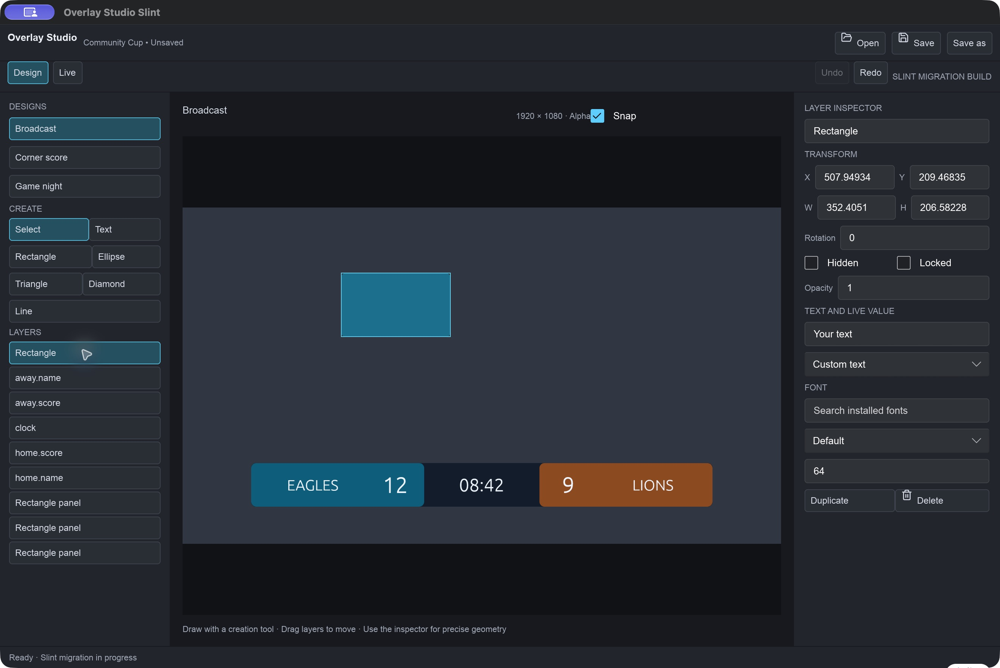
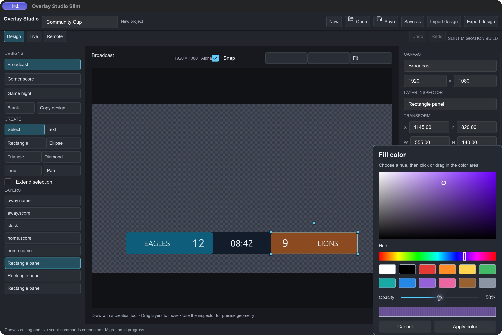
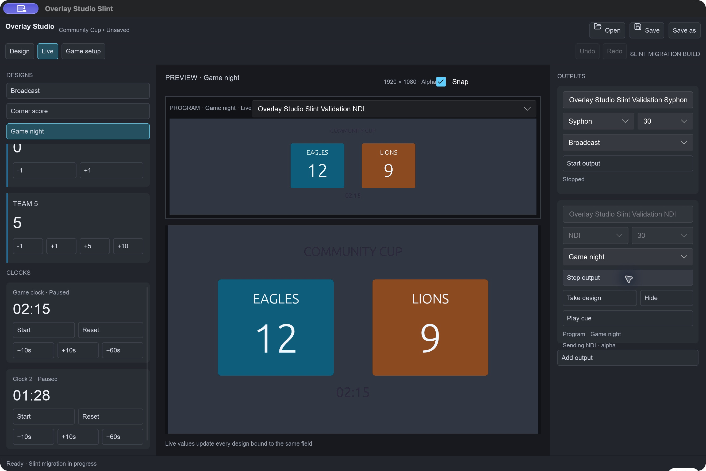
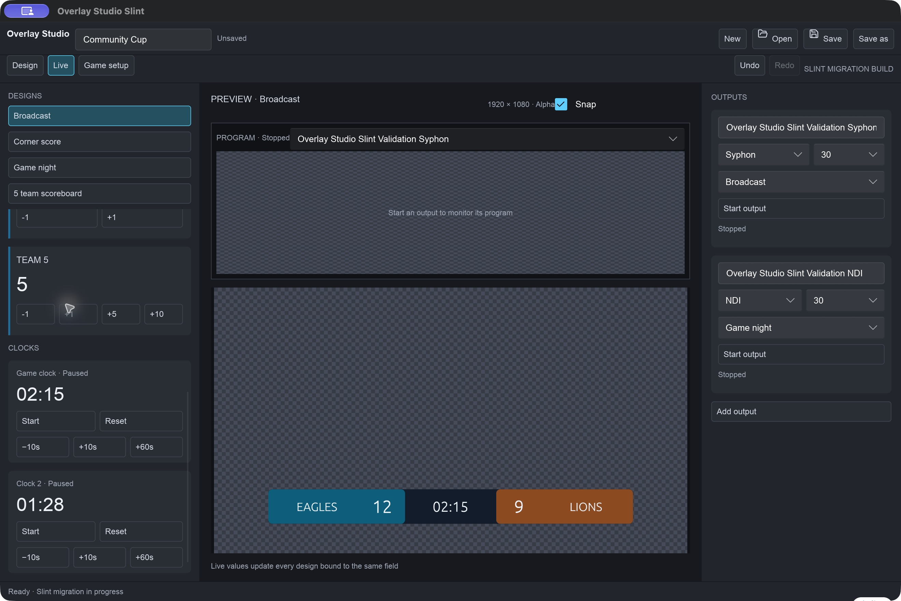
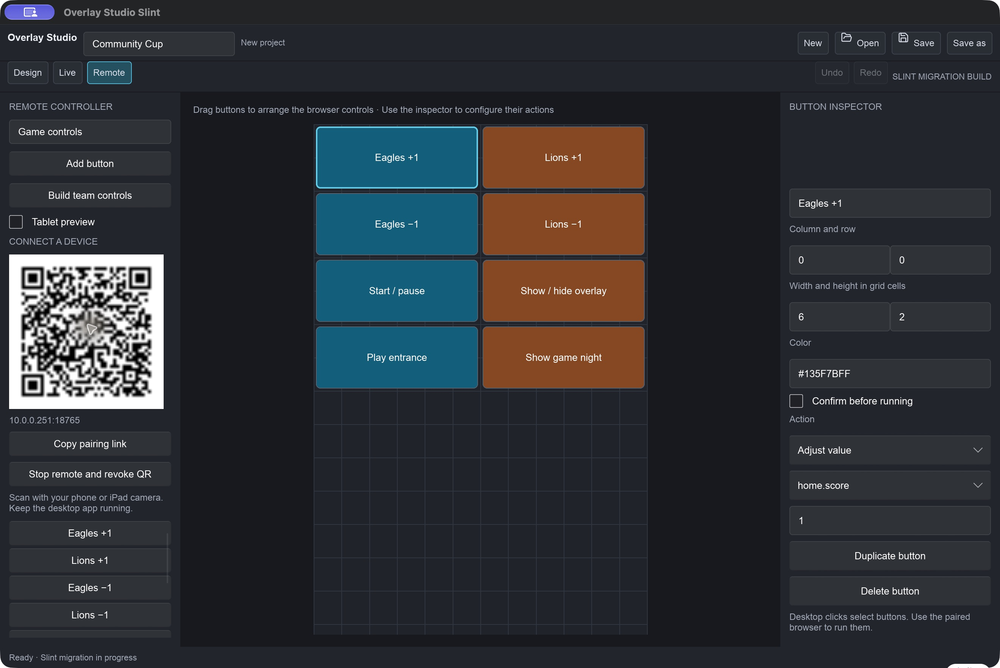
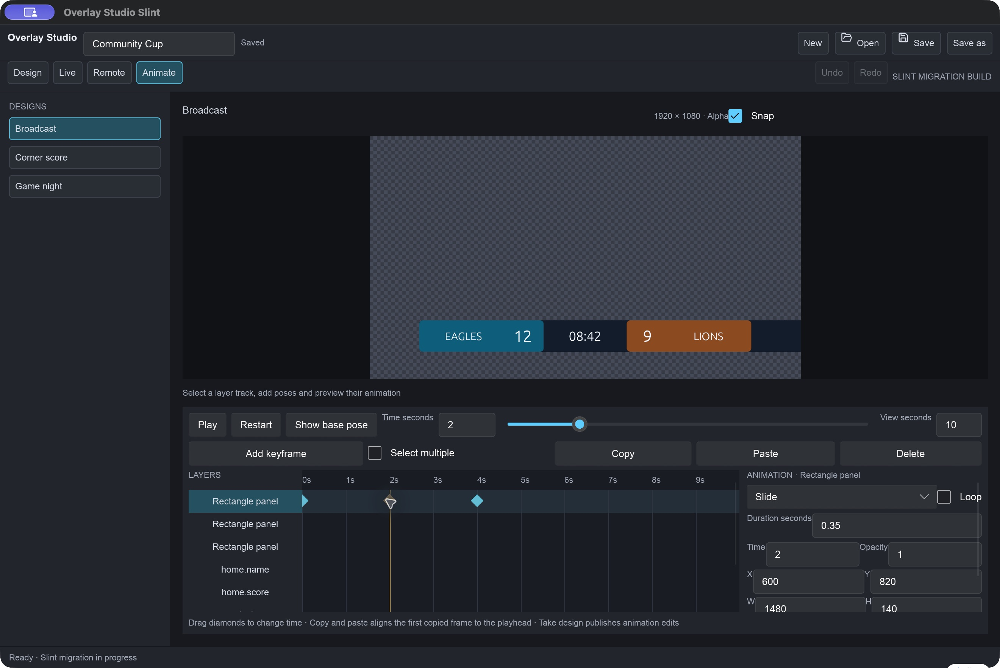
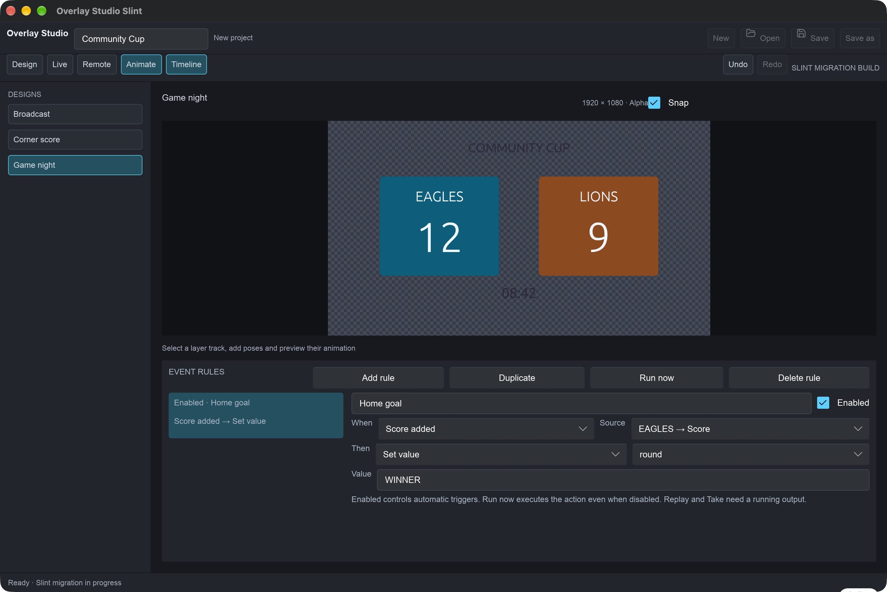
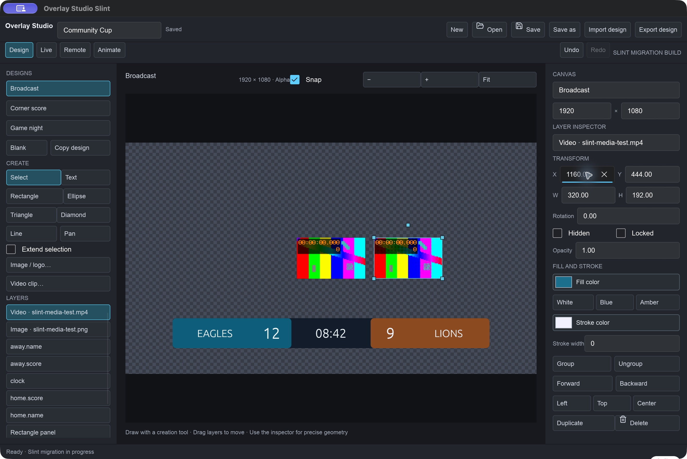
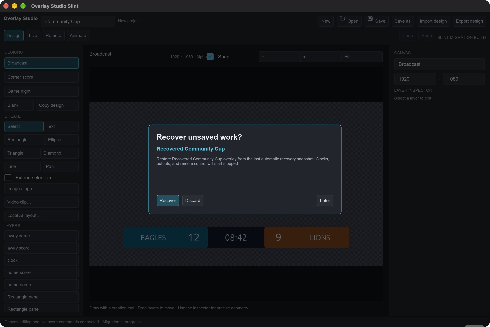

# Overlay Studio

Design transparent scoreboards on macOS, drive scores and clocks live, pair a phone or iPad controller, and send graphics over **NDI** or **Syphon** into tools such as ProPresenter.



## Download

- **Installer DMG:** [Overlay Studio 0.1.0](https://github.com/juandozuna/overlay-studio/releases/tag/v0.1.0) — app + instruction PDF
- **Instruction manual (PDF):** [Overlay Studio Instruction Manual.pdf](docs/manual/output/Overlay%20Studio%20Instruction%20Manual.pdf)

Open the DMG, drag **Overlay Studio** into Applications, then follow the PDF for first-show setup and ProPresenter NDI steps. If macOS blocks the first launch: right-click the app → **Open** → **Open**.

## Screenshots

### Design

Build canvases with text, shapes, images, and video. Bind layers to live game values so one project can drive many layouts.




### Live

Operate teams, scoring steps, clocks, and independent NDI/Syphon outputs. **Take design** publishes the current canvas to the running sender.





### Remote

Lay out phone/iPad controls, start remote access, and scan the QR code on the same local network.



### Animate & events

Keyframe layer motion on the timeline, then automate cues from score or clock events.





### Media & recovery

Import images and short video clips; recover unsaved work after an unexpected quit.





## Game Night show

The app opens with a five-team **Game Night** project: five 1920×1080 layouts (full grid, top bar, bottom strip, side stack, wheel stage) that you switch with **Take** or the phone buttons, and a prize wheel on the Live workspace. Spin, remove the winner, or restore the original list from the app or the remote controller. Pointer, slice style, palette, custom colors and confetti are options; team colors recolor every layout. Wheel state is saved in the project values (`wheel.*`).

## Run from source

Slint desktop app:

```sh
cargo run --release --manifest-path desktop/slint/Cargo.toml
```

Original egui show build:

```sh
cargo run --release
```

Build a shippable DMG (app + PDF):

```sh
cargo build --release --manifest-path desktop/slint/Cargo.toml
python3 docs/manual/build_slint_pdf.py
python3 scripts/build_dmg.py
```

The DMG is written to `dist/Overlay-Studio.dmg`.

## How it works

| Workspace | What you do |
| --- | --- |
| **Design** | Create canvases, style layers, bind live values, import media |
| **Live** | Scores, clocks, custom fields, start/hide/stop NDI or Syphon outputs |
| **Remote** | Button grid + QR pairing for phone/iPad control |
| **Animate** | Timeline keyframes and event rules |

Checkerboard and editing handles are never transmitted. Empty areas stay transparent for compositing in ProPresenter or other receivers.

**ProPresenter:** Start an NDI output in Live → Take design → in ProPresenter go to **Settings → Inputs**, add a Video Input, choose the Overlay Studio NDI source, then trigger it from the Video Input playlist. Full steps and Renewed Vision links are in the PDF.

## Files

- `.overlay` — project (game, designs, assets, outputs, remote layout)
- `.scoredesign` — portable design export
- Autosave recovery lives under `~/Library/Application Support/Overlay Studio/`

## Validation

```sh
cargo test
cargo test --manifest-path desktop/slint/Cargo.toml
node --check web/controller.js
```
